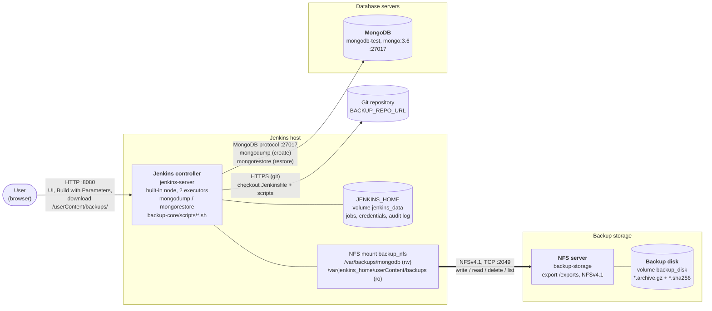

# Architecture overview

The backup system has three parts:

1. **Jenkins server**: the only place where backup work runs (dump, restore, delete, rotate), the only UI for
   users, and the only way to download a backup.
2. **Backup storage**: a file server that exports the backup disk over NFS. It runs no backup logic and no HTTP.
3. **Database servers**: the MongoDB instances that are backed up and restored.

This page describes how they are connected and what runs where. It is based on the test stand
(`test-stand/docker-compose.yml`) and the `myapp-backup` job on `main`.

## Diagram

## Components

| Component | Stand container | Runs | Ports | Storage |
|---|---|---|---|---|
| Jenkins controller | `jenkins-server` (`myapp-jenkins:latest`, `test-stand/jenkins-infra/`) | Jenkins with JCasC; all pipeline steps run on the built-in node (`agent any`, `numExecutors: 2`, no agents configured). `mongodump`, `mongorestore` and the `backup-core/scripts/*.sh` scripts run here. Serves backup downloads. | `8080` (UI), `50000` (inbound agents, unused) | `jenkins_data` → `/var/jenkins_home`; NFS volume `backup_nfs` → `/var/backups/mongodb` (rw) and `/var/jenkins_home/userContent/backups` (ro) |
| Backup storage | `backup-storage` (Alpine + kernel NFS server, `test-stand/backup-storage/`, privileged) | NFS server only: exports `/exports` to the network subnet; every client writes as uid/gid 1000 (`all_squash`) | `2049` (NFSv4), internal network only | `backup_disk` → `/exports` |
| Database server | `mongodb-test` (`mongo:3.6`) | MongoDB; seeded from `test-stand/init-db/` on first start | `27017` | `mongo_test_data` → `/data/db` |

All three containers are in the `jenkins-backup-network` bridge network (`172.28.10.0/24`).
`backup-storage` has the fixed address `172.28.10.10`: the NFS volume is mounted by the Docker daemon, which
does not resolve container names.

## Connections

| # | From | To | Protocol / port | What goes over it |
|---|---|---|---|---|
| 1 | User browser | Jenkins | HTTP `8080` | Login, **Build with Parameters**, backup table, download links `/userContent/backups/<file>` (login required, recorded by Audit Trail, resumable: HTTP Range) |
| 2 | Jenkins | Git repository | HTTPS | Checkout of `.jenkins/Jenkinsfile.backup` and `backup-core/scripts/` from `BACKUP_REPO_URL` / `BACKUP_REPO_BRANCH` on every build |
| 3 | Jenkins | MongoDB | MongoDB protocol `27017` | `mongodump` reads the whole database (create); `mongorestore` writes it back (restore). Credentials: Jenkins credential `mongo-backup-credentials` |
| 4 | Jenkins | Backup storage | NFSv4.1, TCP `2049` | Every file operation on the backup disk: write the archive + `.sha256`, read it for restore, checksum and download, delete, rotate, list |

The storage node never connects anywhere: it only accepts NFS connections from Jenkins.

## What runs where

| Action | Where it runs | Data path |
|---|---|---|
| Storage check (every action) | Jenkins: `check-storage.sh` | Jenkins → (NFS) → storage: disk answers, is mounted, has free space |
| `create` | Jenkins: `db-dump.sh`, then `retention.sh` if `AUTO_ROTATE_AFTER_DUMP` | MongoDB → (27017) → Jenkins → (NFS) → backup disk |
| `restore` | Jenkins: `db-restore.sh` (checks `.sha256` first) | Backup disk → (NFS) → Jenkins → (27017) → MongoDB, into `TARGET_DB` |
| `delete` | Jenkins: `rm` in the pipeline | Jenkins → (NFS) → backup disk |
| `rotate` | Jenkins: `retention.sh` | Jenkins → (NFS) → backup disk |
| Download | Jenkins web server (`/userContent/backups/`), a Jetty request thread per download | Backup disk → (NFS) → Jenkins → (HTTP 8080) → browser |
| Backup table, file list | Jenkins: Active Choices scripts in the build form | Backup disk → (NFS) → Jenkins |

Nothing runs on the database servers or on the storage node: they only accept connections.

## Storage checks and timeout

Before every action the pipeline runs `backup-core/scripts/check-storage.sh`. Settings are hidden job parameters
(`test-stand/jenkins-infra/jobs/myapp-backup.groovy`):

| Setting | Default | Check | Failure |
|---|---|---|---|
| `BACKUP_MOUNT` | `/var/backups/mongodb` | The disk answers within 30 s | `Backup disk does not respond within 30s` |
| | | `BACKUP_MOUNT` is a mount point and `BACKUP_DIR` is on it, so a dump never lands on Jenkins' local disk | `Backup disk is not mounted` / `BACKUP_DIR … is not on the backup disk` |
| `MIN_FREE_SPACE_GB` | `10` | Free space in `BACKUP_DIR` before `create` (`0`: off) | `Not enough free space in …` |
| `PIPELINE_TIMEOUT_HOURS` | `2` | Build timeout | Build aborted |

The NFS volume is mounted `soft` (`timeo=600,retrans=2`): if the storage server goes away in the middle of a build,
file operations fail after about 3 minutes and the build fails instead of hanging. When the server is back, the
mount recovers without restarting Jenkins.

## Network traffic per backup

A `create` moves the backup data over two links:

1. **MongoDB → Jenkins**: `mongodump` pulls the uncompressed database over the network. Compression (`--gzip`)
   happens on the Jenkins side, so this link carries the full data size.
2. **Jenkins → backup storage (NFS)**: the compressed archive.

A `restore` uses the same links in the opposite direction. A download reads the archive over NFS and sends it to
the browser, so the Jenkins host carries it twice (in from storage, out to the user).

Large backups (10 GB and more) work: downloads are streamed and resumable. What to size for them:
`PIPELINE_TIMEOUT_HOURS` (the dump transfers the uncompressed data), `MIN_FREE_SPACE_GB` and the disk itself
(all backups within `RETENTION_DAYS` plus a new one).

## Stand vs. a real deployment

| | Test stand | Real deployment |
|---|---|---|
| Hosts | One Docker host, three containers | ⚠️ Not defined yet: Jenkins, storage and database servers on separate hosts? |
| Backup disk | Volume `backup_disk` in a privileged NFS server container | ⚠️ Not defined yet: which server exports the disk; the Jenkins host mounts it (`/etc/fstab` or the same Docker NFS volume) |
| Database servers | One `mongo:3.6` container | ⚠️ Not defined yet: number of servers and environments, MongoDB version (affects `mongodump`/`mongorestore` version on Jenkins) |
| Network | Docker bridge `jenkins-backup-network` | ⚠️ Not defined yet: firewall rules for 8080 (users → Jenkins), 27017 (Jenkins → MongoDB), 2049 (Jenkins → storage) |
